# Conflux-Weave v0.3 · 深度研究、论文解读与项目解读能力深化重构方案

- **编制日期**：2026-10-08
- **方案状态**：`approved-for-planning`（总纲已确认，进入分阶段规划）
- **核心目标**：从单次浅层任务执行工具，升级为可承受 15–20 分钟长程计算预算、具备自适应学术认知与工业级代码体检能力的自主智能体工作台。

---

## 1. 背景与核心动机

当前 Conflux-Weave 已经完成了基础可用性、多模态索引、进程分离与断点持久化（P6/P7），但在高价值核心能力上仍存在显著瓶颈：

1. **深度研究不够深**：
   - 过去的设计偏向轻量和低延迟，受限于固定源上限（如 `MAX_SOURCES = 10`）和单轮简单问题拆分，产出的报告偏向“摘要拼接”；
   - 在真实严肃研究场景下，用户对时间成本（15–20 分钟）并不敏感，更需要的是**搜索广度穷尽、思考深度穿透、逻辑自洽无遗漏的学术综述级长篇研报**。
2. **论文解读模板化且与图表割裂**：
   - 现有解读逻辑采用固定的章节映射，无法区分方法论文、综述论文与基准测试论文在逻辑结构上的根本差异；
   - 论文中最重要的视觉与数据资产（技术路线图、网络架构图、主实验数据对比表）未能在报告中有效内嵌呈现；
   - 缺乏批处理多篇论文进行横向对比与谱系演进的能力，且无法自主追溯奠基性文献与最新衍生工作。
3. **项目解读偏向浅层符号且缺少对 AI 恶习的体检**：
   - 现有代码分析停留在 AST 符号统计与文件清单罗列，未能深入逆向“为什么这样设计”的架构权衡，也缺少针对用户学习该技术栈的教学路线；
   - 现代 AI 辅助编程（Vibe Coding / Copilot）引入了大量特有恶习（如用全量 Mock 制造虚假单测繁荣、空壳桩代码伪装完成度、静默吞异常，以及**动辄搞哈希冻结、基线清单、全量重复测试等官僚式防御与仪式感浪费**），系统亟需具备对其进行靶向诊断并给出重构方案的能力。

---

## 2. 三大核心模块重构技术蓝图

```mermaid
flowchart TD
    subgraph S1["模块一 · 深度研究引擎 (Deep Research V2)"]
        DR_Plan["1. 综述级假设树规划\n(5-7 章节, 20+ 子切面)"]
        DR_Search["2. 广度/深度递归探索图\n(多源并发, 2-3 跳网页/论文爬取)"]
        DR_Reflect["3. 证据缝隙与冲突反思\n(动态定向补捞未决论题)"]
        DR_Synthesize["4. 万字综述长篇分章合成\n(挂载演进谱系与对比矩阵)"]
        DR_Plan --> DR_Search --> DR_Reflect --> DR_Synthesize
    end

    subgraph S2["模块二 · 论文解读与文献引申 (Paper Reading V2)"]
        PR_Classify["1. 论文范式自适应判定\n(算法型 / 综述型 / 评测型)"]
        PR_Visual["2. 图表/表格物理定位嵌入\n(路线图、主实验表、消融图)"]
        PR_Graph["3. 免Key双向引用引申\n(OpenAlex/SemanticScholar/arXiv)"]
        PR_Batch["4. 多篇论文跨文献横向对比\n(范式矩阵、思想演进分析)"]
        PR_Classify --> PR_Visual --> PR_Graph --> PR_Batch
    end

    subgraph S3["模块三 · 项目解读与实战导师 (Project Dissection V2)"]
        PD_Why["1. 架构动机逆向工程\n(Why instead of What, 决策权衡)"]
        PD_Tutor["2. 技术栈导师与渐进学习路线\n(底层依赖解剖, 保姆级精读导航)"]
        PD_Audit["3. AI 恶习与官僚防御专项体检\n(Mock假象/伪装空壳/仪式感防御过当)"]
        PD_Why --> PD_Tutor --> PD_Audit
    end
```



---

## 3. 模块一详细设计 · 深度研究（Deep Research V2）

### 3.1 核心范式演进
从“一次性扁平检索拼接”重构为**“STORM / MindSearch 风格的假设树驱动递归探索与反思流”**。

### 3.2 阶段划分与时间预算 (15~20 min 模型)
1. **Phase 1: 假设树与综述大纲规划 (1~2 min)**：
   - 将用户复杂课题动态分解为 5~7 个具有逻辑递进关系的综述章节；
   - 细化派生 20+ 个具体的定向研讨论题与事实核查探针。
2. **Phase 2: 广度与深度多源递归检索 (5~8 min)**：
   - 检索源扩充至 60~120 篇高价值源（涵盖 arXiv、学术论文、技术白皮书、官方架构设计）；
   - **递归展开 (Recursive Spanning)**：对权威文献中引述的核心规范、前序关键论文自动执行 2~3 跳深度爬取。
3. **Phase 3: 证据缝隙审计与反思补捞 (2~3 min)**：
   - 专职 Reviewer 机制分析全篇论点覆盖度，定位“证据空白”与“数据口径冲突”；
   - 动态派发 5~10 个二次定向补捞 Query，彻底消灭信息真空。
4. **Phase 4: 分章长篇合成与证据闭环 (6~8 min)**：
   - 逐章流式撰写 8,000~15,000 字的高密度技术综述；
   - 包含技术演进谱系图（Mermaid Timeline）、各流派全维度横向对比矩阵、实战落地权衡（Trade-offs）与封闭式引用台账。

---

## 4. 模块二详细设计 · 论文解读与文献引申（Paper Reading V2）

### 4.1 文类自适应感知与动态章节大纲
智能体在精读前自动判别论文范式并派发专属大纲：
- **算法/架构类**：核心痛点 -> 理论/系统假设 -> 核心架构与算法流 -> 主实验与消融归因 -> 复现风险与工程边界；
- **综述类**：领域全景背景 -> 分类学演化树（Taxonomy Tree） -> 各流派横向解构 -> 技术演进矛盾与突破 -> 未来开放性方向；
- **评测/数据集类**：评测盲区与新目标 -> 数据构建清洗管线 -> 评测协议与度量严谨性 -> 主流模型基准排行榜 -> 典型失败案例归因。

### 4.2 原生图表与数据表格深度嵌入
- 结合 PyMuPDF 坐标与多模态资产服务，定位 PDF 中所有 Figure 与 Table；
- 视觉与语义模型联合识别 `Architecture-Diagram`（路线架构图）、`Performance-Table`（主实验性能表）、`Ablation-Chart`（消融趋势图）；
- 将原切片直接内联嵌入 Markdown 正文，并在其下方挂载针对图表数据流、参数对比的专属深度解读段落。

### 4.3 免 Key 双向引用网络延伸
**零商业 API Key 依赖**，基于完全公开学术接口：
- **后向追溯（Backward References）**：基于 OpenAlex / arXiv API 及 PDF References 正则提取，识别 2~3 篇奠基性工作，解析本文理论源流；
- **前向追踪（Forward Citations）**：调用 OpenAlex 开放端点追踪引用本文的最新工作，总结后序研究对本文提出的改进、变体或质疑；
- **离线降级**：网络不可用时自动解析本地 PDF 参考文献，保持单机功能稳定可用。

### 4.4 批处理多篇论文横向对比研读
- 支持用户一次性加载 2~5 篇相关论文；
- 输出多维度对齐矩阵（假设差异、算法开销、基准高下），绘制思想演进与技术继承路线。

---

## 5. 模块三详细设计 · 项目解读与实战导师（Project Dissection V2）

### 5.1 架构动机逆向工程（The 'Why' Behind the Code）
- 提取项目顶层心智模型（Mental Model）；
- 解剖关键设计权衡（如为什么选某数据库、某调度模型、状态持久化是如何取舍的）；
- 自动生成 Mermaid 模块分层拓扑图与端到端核心数据流序列图。

### 5.2 技术栈导师教学与渐进源码精读路线
- 自动扫描核心三方依赖，输出针对初学者与进阶者的技术原理解析卡片；
- 提供“自顶向下”保姆级源码精读路线图（数据基石 -> 核心引擎 -> 外部边界 -> 异常韧性）。

### 5.3 “AI 编程恶习与官僚防御过当”专项深度体检
建立 7 大维度靶向体检矩阵：
1. **官僚防御与仪式感浪费 (Bureaucratic Ritualism)**：标记动辄生成无意义 hash 校验、冗余 baseline 冻结清单、多层死深防卫包装、微小修改触发无关全量回归等形式主义浪费；
2. **Mock 假象 (Mock Illusion)**：识别测试中滥用 mock 隔离一切真实环境、缺少端到端集成测试的自嗨型单测；
3. **空壳与伪实现 (Stub / Placeholder)**：排查充斥 `pass`、`TODO`、返回死数据的虚假完成度；
4. **静默吞异常 (Silent Swallowing)**：定位滥用裸 `except Exception: pass` 掩盖致命错误的代码点；
5. **幽灵配置与参数幻觉 (Phantom Configs)**：揪出配置文件中声明了但代码中从未消费的死配置；
6. **死深防御性废代码 (Zombie Defensiveness)**：识别多层无意义的重复 None 检查与逻辑冗余；
7. **真实架构隐患 (Architectural Vulnerabilities)**：排查内存泄漏、未关闭连接、并发竞态与硬编码凭据。

最终输出《项目体检诊断书》并给出精准的代码重构 Diff 方案。

---

## 6. 三阶段实施演进路线

```text
阶段一：深度研究长程递归综述引擎 (Deep Research V2)
  ├─ 1.1 研报大纲与假设树动态生成器 (STORM 风格多切面规划)
  ├─ 1.2 多源异步递归探索图 (学术源/技术文档深度追踪，60-120 来源)
  ├─ 1.3 证据缝隙与冲突自省补捞环 (动态发现空白并二次回捞)
  └─ 1.4 万字长篇综述分章合成器 (挂载 Checkpoint 容错与对比矩阵)

阶段二：论文自适应精读与文献图谱引申 (Paper Reading V2)
  ├─ 2.1 论文范式自适应分类器与定制大纲生成
  ├─ 2.2 论文关键图表(架构/消融/表格)多模态提取与正文内联嵌入
  ├─ 2.3 免 Key 双向引用网络延伸器 (OpenAlex / arXiv / 本地正则)
  └─ 2.4 多篇论文联合研读与范式横向对比矩阵生成

阶段三：项目深度导师与 AI 恶习体检官 (Project Dissection V2)
  ├─ 3.1 架构设计动机逆向工程 (Why 决策分析与 Mermaid 拓扑图)
  ├─ 3.2 技术栈通识教学与保姆级源码精读路线导航
  └─ 3.3 “AI 恶习与官僚防御过当”专属规则引擎与体检报告器
```
