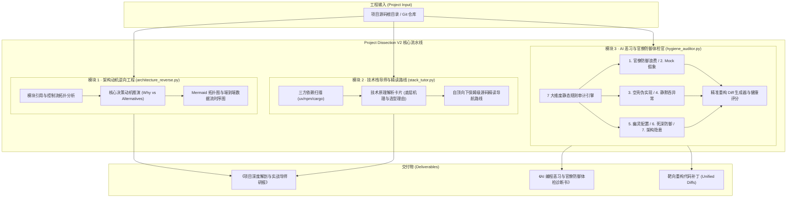

# Conflux-Weave v0.3 · 阶段三：项目深度导师与 AI 恶习体检官 (Project Dissection V2) 具体规划与技术设计

- **编制日期**：2026-10-08
- **执行性质**：阶段三具体架构规格与开发实现方案
- **依据文档**：`v0.3-深度研究-论文解读-项目解读能力深化重构方案.md`
- **基线版本**：`main@a2f8104`（867 passed 全绿，前端构建 0 错误）
- **核心定位**：从传统的浅层符号文件清单罗列，升级为兼备**架构设计动机逆向工程、技术栈通识教学导师、以及靶向扫描 AI 恶习与官僚防御过当深度体检官**的新一代工业级工程认知工作台。

---

## 1. 架构目标与技术规格

### 1.1 三大核心模块度量契约 (Design Contracts)

| 功能模块 | 现有实现局限 (Legacy Dissection) | 阶段三重构目标 (Project Dissection V2) | 关键技术实现 |
|---|---|---|---|
| **1. 架构动机逆向工程** | 停留在 AST 符号统计与目录树展示，只知 What 不知 Why | **逆向解剖架构动机 (Why)**：设计权衡分析、模块分层 Mermaid 拓扑图、核心业务数据流 Sequence 时序图 | 模块依赖拓扑分析 + 数据流 AST 追踪 + 决策权衡对比矩阵 |
| **2. 技术栈导师与源码精读** | 简单的文件列表导航，缺乏依赖原理解析与教学引导 | **全链路通识导师**：三方核心依赖原理卡片、自顶向下渐进式精读路线（基石->引擎->边界->容错） | 依赖清单深度扫描 (`pyproject/package.json/Cargo`) + 依赖原理知识库 + 分级认知导航 |
| **3. AI 恶习与官僚体检官** | 仅给出通用的 3 条粗粒度 advice，无法诊断现代 AI 编程缺陷 | **7 大维度靶向体检矩阵**：官僚防御与仪式感浪费、Mock 假象、空壳伪实现、静默吞异常、幽灵配置、死深防御、真实隐患 | AST 语法树遍历 + 模式规则匹配 + 代码定位诊断 + 重构 Diff 建议 |

---

## 2. 核心模块拓扑与流水线设计



---

## 3. 7 大维度 AI 恶习体检矩阵规范 (`hygiene_auditor.py`)

1. **官僚防御与仪式感浪费 (Bureaucratic Ritualism)**：
   - 识别动辄生成无意义哈希冻结、过度锁基线清单、形式主义多层包裹函数与重复全量校验；
2. **Mock 假象 (Mock Illusion)**：
   - 识别单测中将所有真实依赖全部替换为 `MagicMock()`，导致通过率 100% 但在真实环境下一跑就崩的“虚假安全感”；
3. **空壳与伪实现 (Stub / Placeholder)**：
   - 排查函数/方法体中仅写 `pass`、`...`、`raise NotImplementedError` 或返回固定死数据硬编码的伪装完成度；
4. **静默吞异常 (Silent Swallowing)**：
   - 定位裸 `except:`、`except Exception: pass` 遮蔽真实崩溃的代码点；
5. **幽灵配置与参数幻觉 (Phantom Configs)**：
   - 扫描配置文件/环境变量中声明了但代码库中从未调用的死配置；
6. **死深防御性废代码 (Zombie Defensiveness)**：
   - 识别连续无意义重复 None 检查、三重保护性分支等过度防御冗余；
7. **真实架构隐患 (Architectural Vulnerabilities)**：
   - 排查文件与网络连接未关闭、并发竞态条件、硬编码密钥与明文 Token。

---

## 4. 数据契约与对象模型 (`src/conflux_weave/project_tutor/spec.py`)

### 4.1 架构动机与权衡模型
```python
@dataclass(frozen=True)
class ArchitecturalDecision:
    topic: str                     # 如 "持久化选型", "异步任务调度"
    chosen_solution: str           # 如 "SQLite WAL + Local Artifact Store"
    rejected_alternatives: tuple[str, ...] # 如 ("PostgreSQL 分布式集群", "纯内存状态")
    core_rationale: str            # 选型背后的核心为什么 (Why)
    tradeoffs_accepted: str        # 接受的权衡代价

@dataclass(frozen=True)
class ArchitectureMotivations:
    mental_model_summary: str
    decisions: tuple[ArchitecturalDecision, ...]
    topology_mermaid: str
    dataflow_sequence_mermaid: str
```

### 4.2 技术栈导师与精读路线模型
```python
@dataclass(frozen=True)
class DependencyKnowledgeCard:
    package_name: str
    category: str                  # "核心计算", "网络与IO", "数据存储", "工程治理"
    role_in_project: str
    underlying_mechanism: str
    why_needed: str

@dataclass(frozen=True)
class CodeWalkthroughStage:
    stage_index: int
    stage_name: str                # 如 "第一阶段：数据基石与契约定义"
    core_theme: str
    key_files: tuple[str, ...]
    reading_tips: str
```

### 4.3 AI 恶习与体检报告模型
```python
class HygieneCategory(str, Enum):
    BUREAUCRATIC_RITUALISM = "bureaucratic_ritualism"  # 官僚防御与仪式感浪费
    MOCK_ILLUSION = "mock_illusion"                    # Mock 假象
    STUB_PLACEHOLDER = "stub_placeholder"              # 空壳与伪实现
    SILENT_SWALLOWING = "silent_swallowing"            # 静默吞异常
    PHANTOM_CONFIG = "phantom_config"                  # 幽灵配置与幻觉
    ZOMBIE_DEFENSIVENESS = "zombie_defensiveness"      # 死深防御性废代码
    ARCHITECTURAL_VULNERABILITY = "architectural_vulnerability" # 架构隐患

@dataclass(frozen=True)
class HygieneAuditFinding:
    finding_id: str
    category: HygieneCategory
    severity: str                  # "critical" | "warning" | "info"
    file_path: str
    line_number: int
    code_snippet: str
    issue_description: str
    harm_analysis: str
    refactor_diff_suggestion: str

@dataclass(frozen=True)
class ProjectHygieneReport:
    project_path: str
    hygiene_score: int             # 0 ~ 100
    total_findings_count: int
    findings_by_category: dict[str, int]
    findings: tuple[HygieneAuditFinding, ...]
    executive_verdict: str
```

---

## 5. 实施排期与任务划分

1. **Task 1: 核心契约与数据模型 (`spec.py`)**；
2. **Task 2: 架构动机逆向工程器 (`architecture_reverse.py`)**；
3. **Task 3: 技术栈通识导师与渐进式精读导航器 (`stack_tutor.py`)**；
4. **Task 4: AI 恶习与官僚防御专项体检引擎 (`hygiene_auditor.py`)**；
5. **Task 5: 端到端综合调度器 (`workflow.py` 与 `__init__.py`)**；
6. **Task 6: FastAPI 路由与 Workbench 前端对接 (`server.py`, `api_contracts.py`, `workbench.ts`, `api.ts`)**；
7. **Task 7: 专项与回归测试验证 (`tests/test_project_tutor_*.py`)**。
