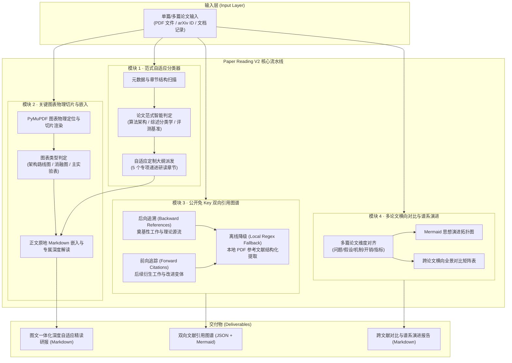

# Conflux-Weave v0.3 · 阶段二：论文自适应精读与文献图谱引申 (Paper Reading V2) 具体规划与技术设计

- **编制日期**：2026-10-08
- **执行性质**：阶段二具体架构规格与开发实现方案
- **依据文档**：`v0.3-深度研究-论文解读-项目解读能力深化重构方案.md`
- **基线版本**：`main@a6b2bdb`（847 passed 全绿，前端构建 0 错误）
- **核心定位**：从传统的机械式静态章节翻译，全面重构为支持**范式自适应大纲、原生图表物理切片原地嵌入、公开免 Key 双向引用图谱与多论文横向对比演进矩阵**的新一代学术论文深度精读引擎。

---

## 1. 架构目标与技术规格

### 1.1 四大核心模块度量契约 (Design Contracts)

| 功能模块 | 现有实现局限 (Legacy DocumentAgent) | 阶段二重构目标 (Paper Reading V2) | 关键技术实现 |
|---|---|---|---|
| **1. 论文范式自适应分类器** | 统一固定的静态章节翻译映射，方法论文、综述论文与基准测试论文采用相同逻辑 | **三类文类自适应判定**：算法/架构类、综述/分类学类、评测/数据集类，派发针对性定制深度大纲 | 标题/摘要/章节语义启发式规则 + LLM 结构化提取的双轨分类器 |
| **2. 关键图表物理切片与正文嵌入** | 图表作为独立资产孤立展示，与文本解读割裂；报告中无原图内嵌与图表专属深度推演 | **物理精准切片定位**，分类识别路线架构图、消融趋势图、主实验表，**在 Markdown 正文原地嵌入切片并在下方展开多模态深度剖析** | PyMuPDF 坐标切片 + Caption 语义匹配 + 图表类型分类器 + 原地内嵌与数据流解读 |
| **3. 免 Key 双向引用图谱引擎** | 仅支持单向离线查看或简单文本引用，无法追溯前序理论源流与后序最新衍生突破 | **完全公开免 Key** 双向引用网络：后向追溯奠基性工作（理论溯源），前向追踪最新衍生工作（改进/变体/质疑），离线时自动正则解析本地 PDF | OpenAlex 开放端点 + arXiv API + 本地 PDF References 健壮正则状态机 |
| **4. 多篇论文横向对比与谱系演进** | 仅支持单篇独立研读，缺乏多文献联合对比与流派继承关系梳理 | **2~5 篇相关论文一键横向对齐**：全维度对比矩阵（假设差异、架构开销、基准高下）、Mermaid 技术思想演进时间线 | 跨文献实体对齐 + 谱系拓扑排序 + Markdown 密集矩阵生成 |

---

## 2. 核心模块拓扑与流水线设计



---

## 3. 数据契约与对象模型 (`src/conflux_weave/paper_reading/spec.py`)

### 3.1 论文范式与大纲契约
```python
class PaperParadigm(str, Enum):
    ALGORITHM_ARCHITECTURE = "algorithm_architecture"  # 算法/架构类
    SURVEY_TAXONOMY = "survey_taxonomy"              # 综述/分类学类
    BENCHMARK_DATASET = "benchmark_dataset"          # 评测/数据集类

@dataclass(frozen=True)
class ReadingChapterSpec:
    key: str
    title: str
    target_aspect: str
    expected_visual_types: tuple[str, ...]

@dataclass(frozen=True)
class AdaptiveReadingOutline:
    paradigm: PaperParadigm
    confidence: float
    rationale: str
    chapters: tuple[ReadingChapterSpec, ...]
```

### 3.2 图表物理切片与嵌入模型
```python
class VisualAssetType(str, Enum):
    ARCHITECTURE_DIAGRAM = "architecture_diagram"  # 系统路线图/网络架构图
    ABLATION_CHART = "ablation_chart"              # 消融趋势图/敏感性分析图
    PERFORMANCE_TABLE = "performance_table"        # 主实验数据对比表
    GENERIC_FIGURE = "generic_figure"
    GENERIC_TABLE = "generic_table"

@dataclass(frozen=True)
class PhysicalVisualSlice:
    asset_id: str
    page: int
    asset_type: VisualAssetType
    caption: str
    image_rel_path: str        # 物理切片文件路径或 API URI
    bbox: tuple[float, float, float, float] | None
    deep_analysis: str         # 针对该图表的专属数据流与关键指标剖析
```

### 3.3 免 Key 双向引用图谱契约
```python
@dataclass(frozen=True)
class CitationItem:
    paper_id: str
    title: str
    authors: tuple[str, ...]
    year: int | None
    venue: str | None
    doi: str | None
    arxiv_id: str | None
    citation_type: str  # "backward_foundation" | "forward_derivative" | "local_reference"
    summary_or_context: str
    relevance_score: float = 1.0

@dataclass(frozen=True)
class DualCitationGraph:
    seed_paper_title: str
    seed_paper_id: str
    backward_foundations: tuple[CitationItem, ...]  # 理论源流与奠基工作 (2~5 篇)
    forward_derivatives: tuple[CitationItem, ...]   # 后续最新衍生突破 (2~5 篇)
    local_references_count: int
    mermaid_graph: str
```

### 3.4 跨论文对比与谱系演进契约
```python
@dataclass(frozen=True)
class PaperComparisonEntity:
    paper_id: str
    title: str
    year: int
    paradigm: PaperParadigm
    core_problem: str
    key_architecture_mechanism: str
    compute_space_overhead: str
    main_benchmark_metrics: str
    tradeoffs_and_risks: str

@dataclass(frozen=True)
class CrossPaperComparativeMatrix:
    papers: tuple[PaperComparisonEntity, ...]
    dimension_matrix_markdown: str
    lineage_mermaid_timeline: str
    synthesis_narrative: str
```

---

## 4. 实施排期与任务划分

1. **Task 1: 核心契约与范式分类器 (`spec.py` + `classifier.py`)**：
   - 规则与启发式特征识别（关键词、章节名、摘要模式匹配）；
   - LLM 结构化提取与容错回退机制；
   - 针对三大范式的深度大纲生成逻辑。
2. **Task 2: 关键图表物理切片与正文原地嵌入 (`visual_inliner.py`)**：
   - PyMuPDF 物理提取与切片生成；
   - 启发式与视觉关键词判定图表类别（架构图/消融图/主实验表）；
   - 生成图表专属深度推演内容并在对应章节中原地内嵌。
3. **Task 3: 公开免 Key 双向引用图谱引擎 (`citation_engine.py`)**：
   - OpenAlex 开放端点查询（前向引用、后向引用）；
   - arXiv / 本地 PDF 正则引用提取回退；
   - 奠基性工作与后序衍生解析，生成 Mermaid 引用网络图。
4. **Task 4: 多篇论文横向对比与谱系演进矩阵 (`cross_paper_matrix.py`)**：
   - 2~5 篇论文结构化实体提取与多维对齐；
   - 渲染高密度 Markdown 对比矩阵与 Mermaid 演进时间线。
5. **Task 5: 端到端 Paper Reading V2 工作流与 API 暴露 (`workflow.py`, `server.py`, `api_contracts.py`)**：
   - 整合四大模块，输出完整的 Paper Reading V2 研报；
   - 暴露 `/api/v1/paper-reading/*` 端点；
   - 更新前端 API Client 与类型定义，并执行前端打包。
6. **Task 6: 单元测试与端到端验证 (`tests/test_paper_reading_*.py`)**：
   - 全套测试覆盖，验证 0 回归，全绿通过。
